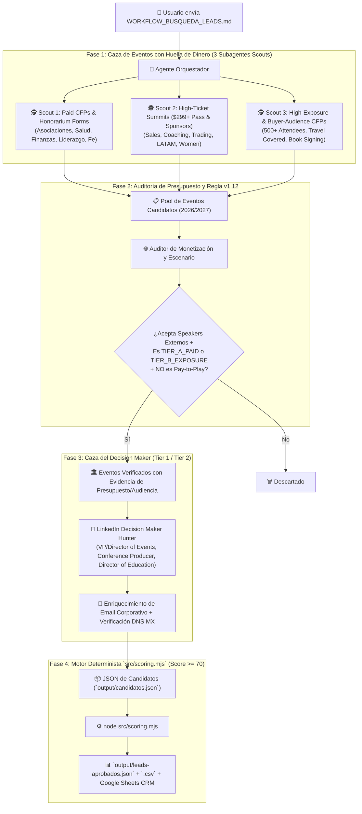

# 🚀 PLAYBOOK Y WORKFLOW DE AUTOMATIZACIÓN v2.0: CAZADOR DE EVENTOS PAGOS & CFPs DE ALTO ROI

> **Instrucción de disparo (Trigger)**: Cuando el usuario envíe o invoque este archivo (`WORKFLOW_BUSQUEDA_LEADS.md`), el Agente Orquestador ejecutará este pipeline de principio a fin priorizando **Eventos que Pagan Honorarios (`TIER_A_PAID_GIG`)** y **Eventos con CFP de Alta Exposición/Audiencia Compradora (`TIER_B_HIGH_EXPOSURE_CFP`)**.

---

## 💰 1. Regla de Monetización v2.0 (El Filtro Anti-CFP Gratis)

La mayoría de los CFPs abiertos en internet son para llenar sesiones paralelas gratuitas o son *Pay-to-Play* (cobran al speaker por hablar). **Este workflow descarta automáticamente cualquier CFP de bajo valor o Pay-to-Play** y clasifica los eventos en dos únicas categorías aprobadas:

| Clasificación (`monetizationTier`) | Criterios de Aprobación Obligatorios | Modelo de Negocio para SpeakUp Express |
| :--- | :--- | :--- |
| 🥇 **`TIER_A_PAID_GIG`** *(Prioridad #1 — Pagan Fee / Honorarium)* | Cumple >=1:<br>1. Su formulario o página menciona explícitamente **`honorarium`**, **`speaker fee`**, **`stipend`**, **`compensated`**, **`paid keynote`**, o pide *"standard speaking fee range"*.<br>2. Es una **Conferencia Anual de Asociación Nacional/Estatal** o **Summit Comercial High-Ticket** (tickets **>= $299 USD** + **Title/Platinum Sponsors** + historial de contratar *Keynote Speakers* profesionales externos). | **Doble vía de monetización**:<br>- Colocar a los **12 speakers del roster** (`ROSTER_OR_EXTERNAL_PAID_GIG`).<br>- Si es un nicho externo rentable, colocar a un **speaker fuera del roster y cobrar comisión (20-25%)** (`EXTERNAL_COMMISSION_OPPORTUNITY`). |
| 🥈 **`TIER_B_HIGH_EXPOSURE_CFP`** *(Prioridad #2 — Alto ROI / Audiencia Compradora)* | Aunque el CFP no pague fee directo (o solo cubra vuelo/hotel), cumple >=2:<br>1. **Audiencia de Compradores (200 - 2,000+ asistentes)**: CEOs, Founders, Médicos, Inversores, Pastores Senior, Ejecutivos o Dueños de Negocio.<br>2. **Monetización en tarima / Back-of- the-room**: Permite *book signing*, QR de lead generation en pantalla, o acceso VIP a la lista de asistentes.<br>3. **Prestigio / Activos Pro**: TEDx reconocidos, MoneyShow, WBECS, ICF, Mindvalley, Forbes, o entrega video 4K + prensa.<br>4. **Viáticos cubiertos**: Cubre vuelo y hotel (`travel and lodging covered`). | **Posicionamiento y Captación High-Ticket**:<br>- Exclusivo para los **12 speakers del roster** (`ROSTER_PLACEMENT`) que monetizan vendiendo consultoría, coaching, libros o servicios high-ticket a la audiencia. |
| ❌ **`REJECT_PAY_TO_PLAY` / `REJECT_LOW_VALUE_CFP`** | - Pide que el speaker compre un paquete de patrocinio (`pay to speak`, `sponsorship required`).<br>- Evento pequeño/comunitario sin presupuesto ni audiencia de compradores. | **Rechazo inmediato en `src/scoring.mjs`**. |

---

## 🤖 2. Arquitectura del Flujo de Agentes (4 Fases)



---

## 🔎 3. Reglas de Búsqueda (Search Dorks de Dinero y Alto Valor)

### Vector A: Caza Directa de Eventos que Declaran Pagar Honorarios (`TIER_A_PAID_GIG`)
Buscamos páginas de conferencias y asociaciones que incluyen términos de compensación en sus convocatorias:
1. `("call for speakers" OR "speaker application" OR "propose a speaker" OR "speaker inquiry" OR "call for presentations") ("honorarium" OR "speaker fee" OR "speaking fee" OR "stipend" OR "speaker budget") ("2026" OR "2027") -wedding -podcast`
2. `("annual conference" OR "annual convention" OR "leadership summit") ("keynote speaker" OR "call for speakers") ("honorarium" OR "travel and lodging" OR "speaking fee") ("2026" OR "2027")`
3. **Búsqueda en Asociaciones Profesionales (que siempre tienen presupuesto anual para Keynotes)**:
   - `("National Association" OR "Society of" OR "American Association" OR "Institute") ("2026 Annual Conference" OR "2027 Annual Conference") ("call for speakers" OR "call for presentations" OR "speaker proposal")`

### Vector B: Caza de Conferencias Comerciales High-Ticket & Roster Niche (`TIER_A` & `TIER_B`)
1. **Faith, Christian Women, Family & Ministry (Dr. Phillip, Angie, Angelie, Evelena, Jeff)**:
   - `("christian women's conference" OR "church leadership conference" OR "faith conference" OR "pastors conference" OR "womens ministry conference") ("speakers" OR "speaker application" OR "invite") ("2026" OR "2027")`
2. **Sales Revenue, Executive Leadership, ICF Coaching & High Performance (Alex Berman, Russ Katzman, Dr. Phillip, Philip Chan)**:
   - `("sales summit" OR "revenue summit" OR "executive leadership conference" OR "coaching conference" OR "ICF" OR "SHRM" OR "CEO summit") ("call for speakers" OR "apply to speak" OR "speaker inquiry") ("2026" OR "2027") -Vistage -YPO`
3. **Trading, Wealth, Physician/IT Burnout, Wellness & Functional Medicine (Sebastián Uzcategui, Rachel Scheer, Philip Chan)**:
   - `("traders expo" OR "moneyshow" OR "wealth summit" OR "functional medicine conference" OR "integrative health conference" OR "physician wellness" OR "healthcare burnout") ("call for speakers" OR "apply to speak" OR "speakers") ("2026" OR "2027")`
4. **LATAM Business, Career Reinvention & Women in Real Estate/Business (Patricio Larrea, Kelly White, Kimberly Aschman)**:
   - `("hispanic business conference" OR "latino leadership" OR "women in business summit" OR "women in real estate" OR "career reinvention") ("call for speakers" OR "apply to speak" OR "speaker application") ("2026" OR "2027")`

### Vector C: Caza del Decision Maker en LinkedIn para cada Evento Aprobado
En las Asociaciones y Conferencias que **pagan a los speakers**, el comprador del Keynote suele tener uno de estos cargos (todos incluidos en `TIER_1_KEYWORDS` con +50 pts):
- `Conference Producer` / `Senior Conference Producer` / `Executive Producer`
- `Director of Programming` / `Head of Programming` / `VP of Programming`
- `Director of Events` / `VP of Events` / `Head of Events` / `Director of Conferences` / `Director of Meetings`
- `Director of Education` / `VP of Education` / `Chief Learning Officer` *(En asociaciones de EE.UU., el Director of Education o Meetings es quien firma el contrato y presupuesto del Keynote Speaker).*
- `Summit Founder` / `Conference Chair` / `Director of Speaker Curation`

---

## 📋 4. Estructura de Datos Obligatoria por Lead (`companyResearch`)

Para que `src/scoring.mjs` apruebe un lead, el agente debe documentar en `companyResearch`:
```json
"companyResearch": {
  "acceptsExternalSpeakers": "yes",
  "isInternalCorporateEvent": false,
  "isEventAgencyOrVendor": false,
  "isPayToPlay": false,
  "paysSpeakers": "yes",
  "estimatedTicketPriceUSD": 595,
  "estimatedAttendees": 800,
  "highValueExposure": "yes",
  "monetizationEvidence": "Explicitly offers speaker honorarium + travel/hotel on Call for Presentations page; tickets $595; 800+ C-suite/executive attendees."
}
```
